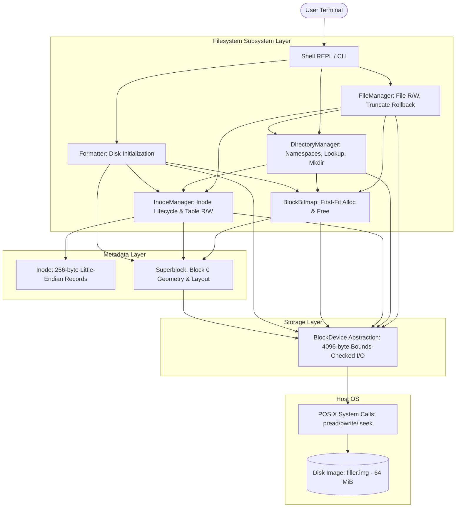

# Filler – Custom Userspace Mini File System

[](https://en.wikipedia.org/wiki/C%2B%2B17)
[](docs/TESTING.md)
[](#)
[](#)

**Filler** is a fully functional, highly reliable userspace file system written in ISO C++17. It operates seamlessly on both **virtual disk image files** (from 64 MiB up to multi-gigabytes) and **physical USB block devices** (such as an HP 16 GB USB flash drive) using classic Unix filesystem principles: a centralized Superblock, dynamic multi-block allocation bitmaps, a scalable Inode Table, hierarchical directory indexing, and multi-level indirect block addressing.

Filler runs entirely in user space and features its own interactive UNIX-like shell REPL, enabling deep study of operating system storage algorithms on real storage hardware without the risk of host kernel crashes.

---

## Table of Contents

- [1. Project Overview](#1-project-overview)
- [2. Verified Features](#2-verified-features)
- [3. Technology Stack](#3-technology-stack)
- [4. High-Level Architecture](#4-high-level-architecture)
- [5. Filesystem Configuration](#5-filesystem-configuration)
- [6. Project Directory Structure](#6-project-directory-structure)
- [7. Build, Test & Run Guide](#7-build-test--run-guide)
- [8. Example Shell Session](#8-example-shell-session)
- [9. Technical Documentation Map](#9-technical-documentation-map)

---

## 1. Project Overview

### What is a Filesystem?
At the physical hardware level, secondary storage devices (SSDs, hard disks, USB drives) present storage as a flat, unorganized array of fixed-size sectors. A **filesystem** is the foundational operating system subsystem that provides structure, persistence, and abstraction over this raw storage. It introduces named files, hierarchical directory trees, metadata attributes (sizes, permissions, timestamps), and space allocation tracking.

### What is a Userspace Filesystem?
Standard production filesystems (such as Linux ext4, Btrfs, or XFS) run inside the OS kernel (Ring 0). A bug in kernel filesystem code causes a kernel panic and crashes the entire machine. A **userspace filesystem** executes as a standard user process (Ring 3). Filler interacts with an underlying 64 MiB regular file (`filler.img`) via standard POSIX system calls (`open`, `read`, `write`, `lseek`, `ftruncate`), treating that file as a virtual physical block device.

### Difference Between Filler and Conventional Linux Filesystems
| Characteristic | Conventional Linux FS (ext4) | Filler Userspace FS |
|---|---|---|
| **Execution Domain** | Kernel Space (Ring 0 VFS) | User Space (Ring 3 Process) |
| **Mount Mechanism** | Native `mount /dev/sda1 /mnt` | Custom interactive Shell REPL |
| **Crash Blast Radius** | Kernel Panic (reboot required) | Process crash (host completely safe) |
| **Crash Protection** | Write-Ahead Journaling (JBD2) | Truncate rollback & ordered unlinking |
| **Addressing** | Extent trees (`struct ext4_extent`) | 16 Direct + Single + Double Indirect |
| **Debugging** | Kernel debuggers (`kgdb`, JTAG) | Standard userspace debuggers (`gdb`, Valgrind) |

### Core Operating Systems Concepts Demonstrated
1. **Block Storage Abstraction**: Translating high-level stream I/O into 4096-byte block read/write operations.
2. **Metadata Serialization**: Little-endian binary serialization guaranteed across CPU architectures.
3. **Space Management**: First-fit allocation and double-free protection using compact bitmaps.
4. **Hierarchical Namespaces**: Directory tree traversal, path tokenization, and packed directory entries.
5. **Multi-Level Indexing**: Direct pointers, single-indirect tables, and double-indirect pointer cascades.
6. **Failure Recovery**: In-memory allocation rollback and ordered deletion to prevent dangling directory references.

---

## 2. Verified Features

Every feature listed below is verified in the C++17 source code and passes automated testing:
- **Interactive Shell REPL**: Integrated shell with prompt tracking current directory (`filler:/docs> `).
- **Directory Hierarchy**: Support for nested directories, `.` (self) and `..` (parent) entries, and absolute/relative path resolution.
- **Multi-Level Block Addressing**: 16 direct block pointers (64 KiB), 1 single-indirect pointer (2 MiB), and 1 double-indirect pointer (1 GiB theoretical capacity).
- **Safe Truncation & Rollback**: Automatic allocation tracking with in-memory rollback that restores modified indirect tables and releases newly allocated blocks if allocation fails midway.
- **Fail-Safe Deletion Ordering**: Unlinks directory entries *before* deallocating inode and data blocks, preventing dangling directory references.
- **Volume Inspection**: Automatic volume classification into `VALID`, `UNFORMATTED`, `CORRUPTED`, `INVALID_IMAGE`, or `IO_ERROR`.
- **Automatic Image Formatting**: Formats blank or undersized images into 64 MiB volumes upon user command.
- **POSIX-Style Shell Commands**: Supports `format`, `pwd`, `cd`, `ls`, `mkdir`, `touch`, `write`, `append`, `cat`, `truncate`, `rm`, `rmdir`, `stat`, `help`, and `exit`.

---

## 3. Technology Stack

- **Language**: C++17 (ISO/IEC 14882:2017)
- **Compiler Flags**: `-std=c++17 -Wall -Wextra -Wpedantic -Werror -O2 -g`
- **Host OS Support**: Linux (Ubuntu, Debian, Fedora, Arch) and macOS (Intel & Apple Silicon)
- **System Call APIs**: POSIX.1-2008 (`open`, `close`, `lseek`, `read`, `write`, `fstat`, `ftruncate`)
- **Build System**: GNU Make with automatic dependency tracking (`-MMD -MP`)
- **Testing Framework**: Custom zero-dependency C++ test runner with failure injection hooks

---

## 4. High-Level Architecture



---

## 5. Filesystem Configuration

Filler enforces strict physical configuration parameters across all components:

| Parameter | Configured Value | Value in Hex / Bytes | Design Rationale |
|---|---|---|---|
| **Disk Image Size** | **64 MiB** | 67,108,864 bytes (`0x04000000`) | Sufficient to demonstrate multi-level indirect blocks; compact enough for instant test execution. |
| **Block Size** | **4096 bytes** | 4,096 bytes (`0x1000`) | Matches host OS page size (x86/ARM); allows exactly 512 64-bit pointers per indirect block. |
| **Total Blocks** | **16,384 blocks** | `0x4000` | \(67,108,864 / 4096 = 16,384\). Fits cleanly in half of a 4096-byte bitmap block. |
| **Inode Size** | **256 bytes** | `0x0100` | Exact power of 2; exactly 16 inodes fit into each 4096-byte inode table block without slack. |
| **Total Inodes** | **256 inodes** | `0x0100` | Balances files against storage size; requires only 32 bytes in the inode bitmap. |
| **Root Inode** | **Inode 1** | `0x00000001` | First valid allocatable inode after reserving Inode 0. Assigned to `/`. |
| **Reserved Inode** | **Inode 0** | `0x00000000` | Sentinel value to prevent uninitialized or zeroed references from pointing to valid files. |
| **Magic Number** | **`0x46494C4C`** | ASCII `"FILL"` | Identifies the disk image as a valid Filler filesystem. |
| **Filesystem Version** | **1** | `0x00000001` | Protects against incompatible on-disk layout modifications. |
| **Serialization** | **Little-Endian** | Explicit bitwise shifts | Ensures binary cross-platform portability between Intel x86 and ARM64. |

---

## 6. Project Directory Structure

```text
Filler/
├── Makefile                        # Build targets for bin/filler and all 9 test suites
├── include/                        # Public C++ header files
│   ├── cli/
│   │   └── Shell.hpp               # Interactive REPL, command dispatch, path resolver
│   ├── fs/
│   │   ├── BlockBitmap.hpp         # Free block bitmap allocation and exhaustion tracking
│   │   ├── DirectoryManager.hpp    # Directory records, lookup, mkdir, rmdir
│   │   ├── FileManager.hpp         # File R/W, sparse gaps, truncate rollback context
│   │   ├── Formatter.hpp           # Disk initialization and region formatting
│   │   ├── Inode.hpp               # 256-byte Inode structure and serialization offsets
│   │   ├── InodeManager.hpp        # Inode table R/W, allocation, boundary isolation
│   │   └── Superblock.hpp          # Superblock header, offsets, and invariant validator
│   └── storage/
│       └── BlockDevice.hpp         # 4096-byte positional block device abstraction
├── src/                            # C++ implementation files
│   ├── main.cpp                    # Binary entry point
│   ├── cli/
│   │   └── Shell.cpp               # REPL loop, command handlers, volume classifier
│   ├── fs/
│   │   ├── BlockBitmap.cpp         # Bitmap allocation algorithms
│   │   ├── DirectoryManager.cpp    # Packed directory record serializer
│   │   ├── FileManager.cpp         # File operations and indirect block traversal
│   │   ├── Formatter.cpp           # Formatting routines
│   │   ├── Inode.cpp               # Inode endianness-safe serializer
│   │   ├── InodeManager.cpp        # Inode table read-modify-write engine
│   │   └── Superblock.cpp          # Superblock serialization and validation logic
│   └── storage/
│       └── BlockDevice.cpp         # POSIX file descriptor wrapper with lseek/read/write
├── tests/                          # Standalone test suites (113 tests total)
│   ├── block_device_test.cpp       # BlockDevice bounds and I/O tests (19 tests)
│   ├── superblock_test.cpp         # Superblock round-trip and validation tests (14 tests)
│   ├── formatter_test.cpp          # Formatter region initialization tests (8 tests)
│   ├── block_bitmap_test.cpp       # Bitmap allocation and exhaustion tests (13 tests)
│   ├── inode_manager_test.cpp      # Inode table and isolation tests (12 tests)
│   ├── directory_manager_test.cpp  # Directory hierarchy and lookup tests (15 tests)
│   ├── file_manager_test.cpp       # Multi-block, indirect, rollback tests (14 tests)
│   ├── cli_test.cpp                # Shell REPL and state classification tests (11 tests)
│   └── integration_test.cpp        # Full end-to-end integration scenarios (7 tests)
└── docs/                           # Comprehensive technical documentation
    ├── ARCHITECTURE.md             # In-depth subsystem architectural guide
    ├── DATA_LAYOUT.md              # Exact on-disk block and byte map
    ├── DESIGN_DECISIONS.md         # Detailed design decision and trade-off log
    ├── INTERNALS.md                # Step-by-step algorithms and pseudocode
    ├── LIMITATIONS.md              # Honest technical constraints and future roadmap
    ├── OPERATIONS.md               # Complete CLI command reference and lifecycle trace
    ├── TESTING.md                  # Testing architecture and failure-injection guide
    └── VIVA_QUESTIONS.md           # 55 OS viva and technical interview questions
```

---

## 7. Build, Test & Run Guide

### Prerequisites
- GCC / G++ (supporting C++17) or Clang++
- GNU Make
- Linux or macOS operating system

### 1. Compile the Project
```bash
make clean && make all
```
This builds the binary at `bin/filler`.

### 2. Run All Test Suites
```bash
make test
```
Runs all 9 test suites (118 tests). Every test must pass with 0 failures:
- `test_block_device`: 21 tests (including 64-bit offsets, properties, 4 GiB sparse device)
- `test_superblock`: 14 tests
- `test_formatter`: 9 tests
- `test_block_bitmap`: 13 tests
- `test_inode_manager`: 12 tests
- `test_directory_manager`: 15 tests
- `test_file_manager`: 14 tests
- `test_cli`: 11 tests
- `test_integration`: 9 tests (including 256 MiB, 1 GiB, 4 GiB sparse volume scaling and safety checks)

### 3. Launching Filler

#### Option A: Virtual Disk Image
```bash
# Launch with default 64 MiB disk image (filler.img)
make run

# Or target a specific image file (creates file if not present):
./bin/filler my_disk.img

# Format an image directly before launching:
./bin/filler --format my_disk.img
```

#### Option B: Physical USB Flash Drive (e.g. HP 16 GB USB Drive)
When targeting a physical Linux block device, run with `sudo` (required for raw block device I/O):
```bash
# Open physical drive (inspects existing filesystem without formatting):
sudo ./bin/filler /dev/sdb

# Or format the drive with safety confirmation before entering the shell:
sudo ./bin/filler --format /dev/sdb
```

---

### Step-by-Step Guide: Testing HP 16 GB USB Flash Drive on Linux VM (UTM on macOS)

To safely test Filler on a physical USB flash drive within a virtualized Linux environment (e.g. Ubuntu running under UTM on Apple Silicon or Intel Mac):

#### Step 1: Connect USB Drive to Host & Pass Through to UTM
1. Insert your **HP 16 GB USB drive** into your Mac.
2. In UTM, start your Linux Virtual Machine.
3. In the UTM VM window toolbar at top right, click the **USB icon** (USB Devices).
4. Select the **HP USB Flash Drive** from the list to redirect it directly into the Linux guest VM.
5. macOS will disconnect the drive and pass raw USB hardware access to the Linux guest.

#### Step 2: Identify the Device Node in Linux
Inside the Linux terminal, run:
```bash
lsblk
```
Look for your 16 GB drive. It will typically appear as `/dev/sdb` (or `/dev/sdc` if you have secondary virtual disks):
```text
NAME   MAJ:MIN RM   SIZE RO TYPE MOUNTPOINTS
sda      8:0    0    64G  0 disk 
├─sda1   8:1    0     1G  0 part /boot
└─sda2   8:2    0    63G  0 part /
sdb      8:16   1  14.9G  0 disk 
└─sdb1   8:17   1  14.9G  0 part /media/user/HP_USB
```

#### Step 3: Ensure Partitions are Unmounted
Filler contains built-in safety protection that refuses to format mounted devices. If your desktop environment auto-mounted the drive, unmount it:
```bash
sudo umount /dev/sdb*
```

#### Step 4: Run Filler with Destructive Format Safeguard
Launch Filler targeting the raw physical drive:
```bash
sudo ./bin/filler --format /dev/sdb
```
Filler will detect the hardware, query capacity via `ioctl(BLKGETSIZE64)`, inspect `/proc/mounts`, and display a confirmation prompt:
```text
WARNING: Target is a physical block device: /dev/sdb
Detected capacity: 16000000000 bytes (3906250 blocks, 14.90 GiB)
All existing data and partitions on this device will be PERMANENTLY DESTROYED!
Type 'YES' to confirm destructive formatting: 
```
Type `YES` and press Enter:
```text
Filesystem successfully formatted.
Filler Mini File System Shell (block device: /dev/sdb, 14.90 GiB)
Type 'help' for available commands or 'exit' to quit.
filler:/> 
```

#### Step 5: Perform Filesystem Operations on Physical Hardware
```text
filler:/> mkdir photos
filler:/> cd photos
filler:/photos> touch info.txt
filler:/photos> write info.txt "Stored on physical HP 16 GB USB Drive!"
filler:/photos> cat info.txt
Stored on physical HP 16 GB USB Drive!
filler:/photos> stat info.txt
filler:/photos> exit
```

#### Step 6: Verify Persistence Across Reconnect
Run without `--format`:
```bash
sudo ./bin/filler /dev/sdb
```
Filler will instantly detect the valid Superblock, load the bitmaps, and mount the filesystem:
```text
Filler Mini File System Shell (block device: /dev/sdb, 14.90 GiB)
Type 'help' for available commands or 'exit' to quit.
filler:/> ls photos
[FILE] info.txt (39 bytes)
filler:/> cat photos/info.txt
Stored on physical HP 16 GB USB Drive!
```

---

## 8. Example Shell Session

Below is a realistic terminal session demonstrating actual supported commands:

```text
$ make run
./bin/filler
Filler Mini File System Shell (image: filler.img)
Type 'help' for available commands or 'exit' to quit.

filler:/> format
Filesystem successfully formatted.

filler:/> ls
[DIR]  .
[DIR]  ..

filler:/> mkdir docs
filler:/> cd docs
filler:/docs> touch notes.txt
filler:/docs> write notes.txt "Welcome to Filler File System!\n"
filler:/docs> append notes.txt "Built with C++17 and multi-level indirect blocks.\n"

filler:/docs> cat notes.txt
Welcome to Filler File System!
Built with C++17 and multi-level indirect blocks.

filler:/docs> stat notes.txt
Inode:       3
Type:        Regular File
Permissions: 0644
UID/GID:     0/0
Size:        80 bytes
Blocks:      1
Access Time: 2026-11-14 13:45:10
Modify Time: 2026-11-14 13:45:10
Change Time: 2026-11-14 13:45:10
Direct Blocks: [ 20, 0, 0, 0, 0, 0, 0, 0, 0, 0, 0, 0, 0, 0, 0, 0 ]
Single Indirect: 0
Double Indirect: 0

filler:/docs> cd ..
filler:/> ls docs
[FILE] notes.txt (80 bytes)

filler:/> exit
```

---

## 9. Technical Documentation Map

For deep technical insights, consult the dedicated guides under [`docs/`](docs/):

- [**docs/ARCHITECTURE.md**](docs/ARCHITECTURE.md): Complete subsystem design, layering, positional I/O, and component interactions.
- [**docs/DATA_LAYOUT.md**](docs/DATA_LAYOUT.md): Exact physical disk map, region boundaries, mathematical mapping formulas, and endianness.
- [**docs/DESIGN_DECISIONS.md**](docs/DESIGN_DECISIONS.md): The "Why" behind every design choice, trade-offs, and alternative analysis.
- [**docs/INTERNALS.md**](docs/INTERNALS.md): Step-by-step algorithms, pseudocode, and time complexities for all 16 core operations.
- [**docs/OPERATIONS.md**](docs/OPERATIONS.md): Comprehensive CLI command guide, file lifecycle traces, and persistence behavior.
- [**docs/TESTING.md**](docs/TESTING.md): Detailed verification suite guide, failure-injection mechanics, and test counts.
- [**docs/LIMITATIONS.md**](docs/LIMITATIONS.md): Honest assessment of missing features (no journaling, no FUSE) and engineering roadmap.
- [**docs/VIVA_QUESTIONS.md**](docs/VIVA_QUESTIONS.md): 55 comprehensive questions and answers for viva or technical interview preparation.

