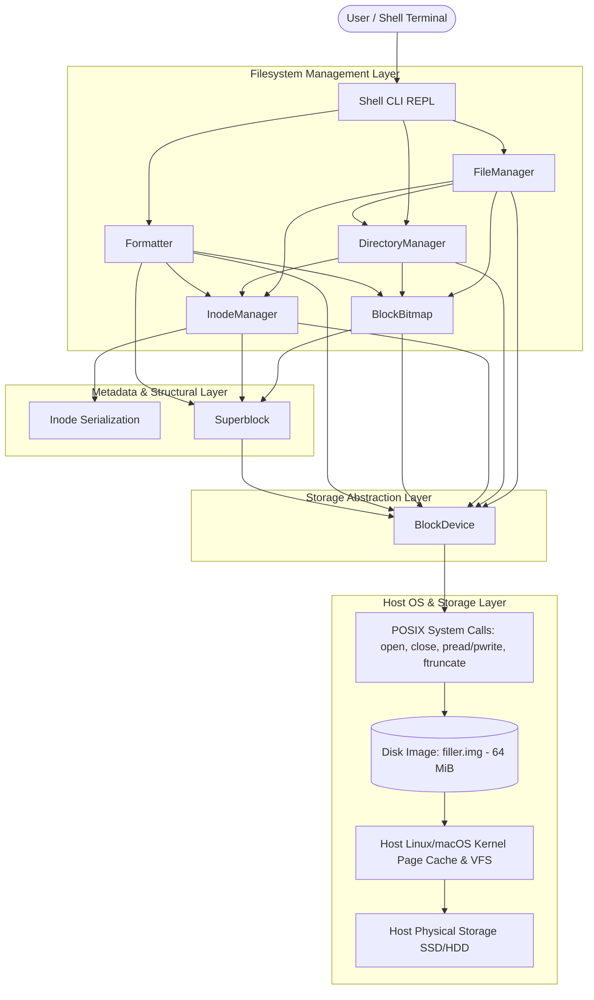
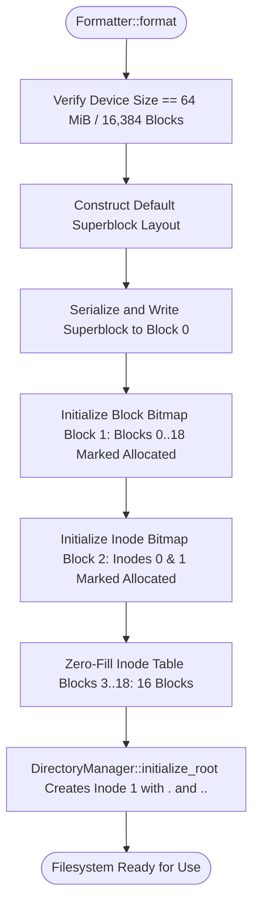
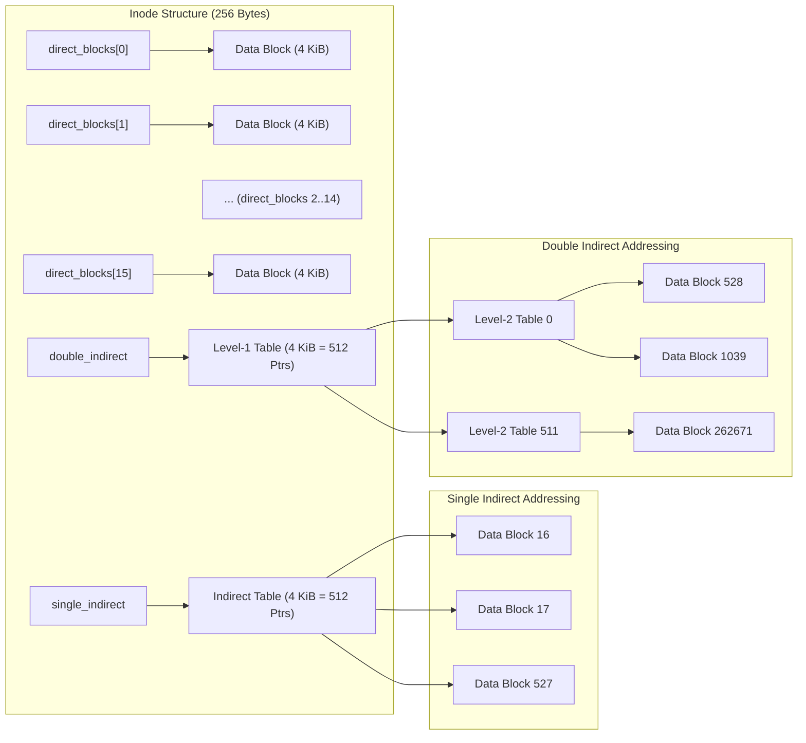
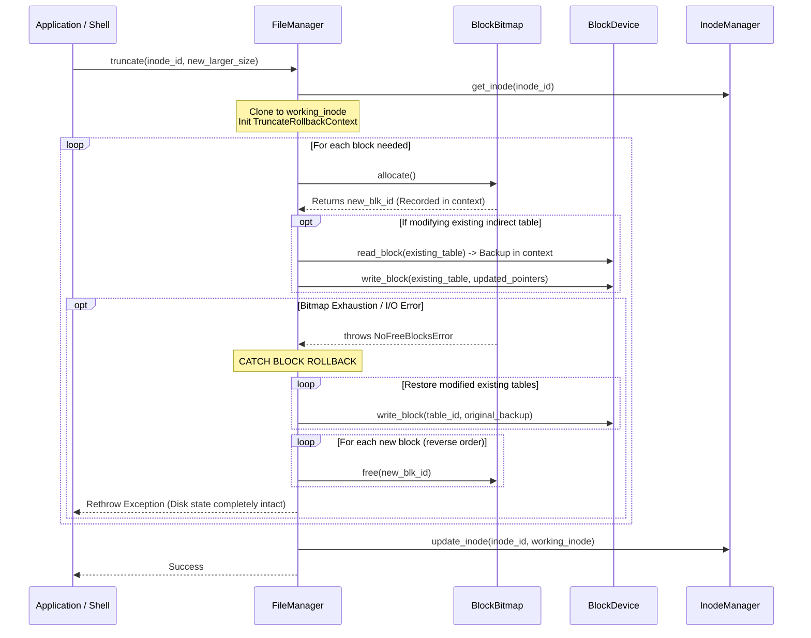

# Filler – Complete System Architecture

This document presents the end-to-end architectural design of **Filler – A Custom Userspace Mini File System**. It details each subsystem, explaining the foundational Operating Systems concept, why it is required, how Filler implements it, component interactions, design trade-offs, and failure handling.

---

## 1. High-Level Architectural Model

Filler is designed as a layered, modular userspace file system written in C++17. Instead of interacting directly with raw disk hardware or implementing a kernel-space VFS driver, Filler manages a fixed-size 64 MiB binary image file on the host OS through a dedicated block device abstraction layer.



---

## 2. Storage Abstraction Layer: `BlockDevice`

### 2.1 The Operating System Concept
In modern operating systems, secondary storage devices (hard drives, NVMe SSDs, flash memory) do not allow random byte-addressable read and write operations at the hardware bus level. Instead, hardware transfers data in fixed-size atomic units known as **sectors** (typically 512 bytes or 4096 bytes). 

An operating system introduces a **Block Device abstraction** to represent storage as an array of numbered blocks \([0, 1, 2, \dots, N-1]\). A filesystem is built on top of this block abstraction to organize files, directories, and metadata without needing to know device-specific driver commands.

### 2.2 Why Filler Implements `BlockDevice`
In userspace filesystems, interacting with an image file using raw POSIX `lseek()`, `read()`, and `write()` scattered across different classes leads to serious vulnerabilities:
1. **Race conditions with file offsets**: Concurrent operations or interrupted sequential reads can leave the seek pointer in an unexpected position.
2. **Partial transfers**: Raw `read()` and `write()` calls may return fewer bytes than requested due to system interrupts.
3. **Leaked low-level concerns**: Subsystems like `FileManager` or `DirectoryManager` should not concern themselves with file descriptors or error numbers (`errno`).

### 2.3 How Filler Implements `BlockDevice` (`src/storage/BlockDevice.cpp`)
The `BlockDevice` class provides dual-mode storage abstraction, operating on either **regular disk image files** or **physical Linux block devices** (e.g. `/dev/sdb` representing an HP 16 GB USB flash drive):
- **Storage Target Detection**: Uses `fstat()` on the file descriptor. 
  - If `S_ISREG`: Operates in regular file mode, obtaining size via `st.st_size`.
  - If `S_ISBLK`: Operates in physical block device mode. Under Linux, queries capacity using `ioctl(fd, BLKGETSIZE64, &bytes)`. Under macOS, queries capacity using `ioctl(fd, DKIOCGETBLOCKCOUNT)` and `ioctl(fd, DKIOCGETBLOCKSIZE)`.
  - Rejects directories and invalid special files with informative error messages.
- **Dynamic 64-Bit Capacity**: Tracks capacity using `uint64_t total_blocks_` and `uint64_t size_bytes_`, supporting volumes from 64 MiB (16,384 blocks) up to multi-terabyte drives with zero 32-bit overflow risk.
- **Positional I/O**: Filler uses positional I/O (`lseek` + full transfer loops or `pread`/`pwrite` semantics) to perform atomic read and write operations at exact byte offsets:
  \[
  \text{offset} = \text{block\_id} \times 4096
  \]
- **Strict Validation**:
  - `block_id >= total_blocks_`: Throws `std::out_of_range`.
  - `buffer == nullptr`: Throws `std::invalid_argument`.
  - `buffer_size < BLOCK_SIZE`: Throws `std::invalid_argument`.
  - Device closed: Throws `std::runtime_error`.
- **Resource Management (RAII)**: Owns the file descriptor. The destructor safely closes `fd_`, and copy operations are deleted to prevent double-closing or file descriptor aliasing. Move semantics (`BlockDevice(BlockDevice&&)`) transfer ownership cleanly.
- **Device Introspection**: Exposes `is_block_device()` and `path()`, allowing higher layers (such as the Shell and Formatter) to enforce physical device safety rules and mount inspections.

```text
Filler Filesystem Layer (Superblock, Bitmaps, Inodes, Directories, Files)
       |
       |  read_block(block_id, buffer, 4096)
       |  write_block(block_id, buffer, 4096)
       v
BlockDevice Abstraction (Checks bounds, manages fd, converts block_id to 64-bit byte offset)
       |
       +---------------------------------------------+
       |                                             |
       v (Regular File: S_ISREG)                     v (Physical Block Device: S_ISBLK)
POSIX pread64/pwrite64 on disk.img           POSIX pread64/pwrite64 on /dev/sdX
       |                                             |
       v                                             v
Host OS Virtual Filesystem (ext4/APFS)        Linux SCSI/USB Block Subsystem (usb-storage / uas)
       |                                             |
       v                                             v
Host Internal Drive (SSD/NVMe)               Physical USB Flash Drive (HP 16 GB Flash Drive)
```

---

## 3. Metadata Descriptor: `Superblock`

### 3.1 The Concept
Every filesystem requires a primary data structure stored at a well-known, fixed location that describes the layout, geometry, version, and integrity of the entire volume. This structure is called the **Superblock**. Without it, an operating system mounting the disk would have no idea where the inode table begins, how large a block is, or where free space is tracked.

### 3.2 How Filler Implements `Superblock` (`src/fs/Superblock.cpp`)
Filler places its superblock at **Block 0** (offset `0`). It serializes exactly 120 bytes of critical filesystem parameters:
- **Magic Number (`0x46494C4C`)**: Identifies the disk as a valid Filler filesystem. In ASCII, these four bytes represent the characters `'F'`, `'I'`, `'L'`, `'L'`.
- **Version (`1`)**: Protects against incompatible on-disk layout changes.
- **Geometry Fields**: Block size (`4096`), inode size (`256`), total blocks (`16384`), total inodes (`256`), root inode ID (`1`).
- **Dynamic Counters**: `free_blocks` (decremented when data blocks or indirect tables are allocated) and `free_inodes` (decremented when files or directories are created).
- **Region Boundaries**: Explicit start blocks and lengths for block bitmap (`1`, `1`), inode bitmap (`2`, `1`), inode table (`3`, `16`), and data region (`19`, `16365`).

### 3.3 Superblock Validation Engine
When Filler mounts or inspects an image, `Superblock::validate()` executes strict integrity checks:
1. Magic number must equal `0x46494C4C`.
2. Version must equal `1`.
3. Block size must equal `4096`.
4. Inode size must equal `256`.
5. Total blocks must be \(\ge 64\) and match the underlying device size.
6. Region offsets must be contiguous, ordered, non-overlapping, and completely cover the device:
   \[
   0 < \text{block\_bitmap\_start} < \text{inode\_bitmap\_start} < \text{inode\_table\_start} < \text{data\_region\_start}
   \]
7. Inode table capacity must be sufficient to hold `total_inodes`.
8. Bitmaps must have sufficient bits to track their respective resources.

---

## 4. Disk Formatter: `Formatter`

### 4.1 The Concept
A newly created storage image is simply a blank file filled with zeroes (or random garbage). **Formatting** is the process of creating the fundamental filesystem data structures on disk: writing the superblock, marking metadata regions as allocated in the bitmaps, clearing the inode table, and establishing the root directory.

### 4.2 Formatting Flow (`src/fs/Formatter.cpp`)



- **Metadata Reservation**: Blocks 0 through 18 are immediately marked allocated (`1`) in the block bitmap. This guarantees that user files can never overwrite the superblock, bitmaps, or inode table.
- **Root Inode Initialization**: Inode 1 is initialized as a directory (`FileType::DIRECTORY`) with permissions `0755`. Its `direct_blocks[0]` is assigned Block 19, which is populated with entries for `.` (pointing to inode 1) and `..` (pointing to inode 1).

---

## 5. Free Space Tracking: `BlockBitmap`

### 5.1 The Concept
Filesystems must rapidly find free disk blocks when writing data and release them when files are deleted or truncated. Two classic approaches exist:
1. **Free list / Linked list**: Free blocks point to the next free block. *Drawback*: Finding contiguous blocks is slow and requires extensive disk I/O.
2. **Bitmap**: A compact array of bits where each bit corresponds to one physical block. *Advantages*: High locality, fits in few blocks, and allows fast scanning.

### 5.2 Filler's Implementation (`src/fs/BlockBitmap.cpp`)
- **Location**: Block 1.
- **Capacity**: 1 block = 4096 bytes = 32,768 bits. Filler uses 16,384 bits (first 2048 bytes).
- **First-Fit Allocation (`allocate()`)**:
  1. Scans memory-cached bitmap bytes starting from the data region (`data_region_start = 19`).
  2. Identifies the first byte that is not `0xFF` (contains at least one `0` bit).
  3. Uses bitwise operations to locate the exact bit index.
  4. Sets the bit to `1`.
  5. Decrements `free_blocks` in the Superblock.
  6. Writes the updated bitmap block to Block 1 and the updated Superblock to Block 0 immediately (synchronous write-through).
  7. Returns the physical `block_id`.
- **Deallocation (`free()`)**:
  1. Validates that `block_id` is within `[data_region_start, total_blocks)`. Attempting to free metadata blocks (0..18) throws `BlockBitmapError`.
  2. Checks whether the bit is currently `0`. If so, throws `BlockBitmapError` to prevent **double-free corruption**.
  3. Clears the bit to `0`.
  4. Increments `free_blocks` in the Superblock and writes updates synchronously to disk.

---

## 6. Metadata Management: `Inode` & `InodeManager`

### 6.1 The Inode Concept
In Unix-like filesystems, a file's name is separate from its metadata. A file's metadata—size, permissions, timestamps, and data block pointers—is stored in an **index node (inode)**. Filenames exist solely inside directories as pointers mapping a human-readable string to an integer **inode number**.

### 6.2 Inode Addressing Scheme

Each 256-byte inode in Filler provides a classic multi-level indexed allocation scheme:



#### Capacity Calculations
1. **16 Direct Pointers**:
   - Covers logical blocks \(0 \dots 15\).
   - Capacity: \(16 \times 4096 = 65,536\) bytes (64 KiB).
2. **1 Single-Indirect Pointer**:
   - Points to a 4096-byte table containing 512 64-bit block pointers (\(4096 / 8 = 512\)).
   - Covers logical blocks \(16 \dots 527\).
   - Capacity: \(512 \times 4096 = 2,097,152\) bytes (2 MiB).
   - Cumulative capacity: \(64\text{ KiB} + 2\text{ MiB} = 2,162,688\) bytes (\(\approx 2.06\) MiB).
3. **1 Double-Indirect Pointer**:
   - Points to a Level-1 table containing 512 pointers to Level-2 tables.
   - Each Level-2 table contains 512 pointers to data blocks.
   - Total data blocks: \(512 \times 512 = 262,144\) blocks.
   - Covers logical blocks \(528 \dots 262,671\).
   - Theoretical capacity: \(262,144 \times 4096 = 1,073,741,824\) bytes (1 GiB).
   - Practical capacity: Entirely covers the 64 MiB disk image (Filler has only 16,365 user blocks).

### 6.3 How `InodeManager` Works (`src/fs/InodeManager.cpp`)
- **Allocation (`allocate_inode`)**:
  - Scans Inode Bitmap (Block 2) starting at inode 2 (skipping reserved inode 0 and root inode 1).
  - Finds the first unset bit, sets it to `1`, decrements `Superblock.free_inodes`.
  - Initializes a fresh `Inode` object with timestamps, type, permissions, zeroed size, and zeroed pointers.
  - Calculates the exact disk block in the Inode Table:
    \[
    \text{block} = 3 + \lfloor \text{inode\_id} / 16 \rfloor, \quad \text{offset} = (\text{inode\_id} \pmod{16}) \times 256
    \]
  - Writes the serialized inode to disk and updates the bitmap block.
- **Access & Updates (`get_inode`, `update_inode`)**:
  - Reads the 4096-byte inode table block, deserializes the 256-byte slice into an `Inode` object.
  - Updates write the modified slice back to disk using read-modify-write on that 4096-byte block.
- **Deallocation (`free_inode`)**:
  - Verifies inode is allocated, not reserved (rejects ID 0 and 1).
  - Clears the bit in the inode bitmap.
  - Zeroes out the 256-byte entry in the Inode Table on disk.

---

## 7. Namespace Organization: `DirectoryManager`

### 7.1 The Concept
Directories provide the hierarchical namespace of the filesystem. A directory is essentially a special file whose content is a list of entries mapping human-readable names (`"foo.txt"`) to inode numbers (`5`).

### 7.2 Directory Implementation (`src/fs/DirectoryManager.cpp`)
- **Direct Block Storage**: Directory entries are stored across the directory inode's `direct_blocks[0..15]`. This supports directories up to 64 KiB, which can hold thousands of entries.
- **Packed 4-Byte Aligned Records**:
  Each entry has: `inode_id` (8 B), `type` (4 B), `name_len` (4 B), and `name` padded to a multiple of 4 bytes.
- **Essential Directory Operations**:
  - `initialize_root()`: Creates `.` (pointing to inode 1) and `..` (pointing to inode 1).
  - `lookup(parent_inode_id, name)`: Scans the directory's data blocks sequentially, parses records, and returns the matching `inode_id`.
  - `add_entry(parent_inode_id, inode_id, type, name)`: Verifies no duplicate name exists, appends the packed record, allocates additional direct blocks if needed, updates the directory inode's `size_bytes`, and syncs to disk.
  - `remove_entry(parent_inode_id, name)`: Locates the entry, removes it from the record list, repacks remaining entries, and frees trailing unused blocks.
  - `mkdir(parent_inode_id, name)`: Allocates a new inode (`FileType::DIRECTORY`), allocates its first data block, writes `.` (pointing to self) and `..` (pointing to parent), and adds the entry to the parent directory.
  - `remove_directory(parent_inode_id, name)`: Rejects deletion if directory is root (`inode 1`), or if it contains user entries other than `.` and `..`.

```text
Directory Tree Structure:
/ (Inode 1, Type: DIR)
├── .  (Inode 1)
├── .. (Inode 1)
├── docs (Inode 2, Type: DIR)
│   ├── .       (Inode 2)
│   ├── ..      (Inode 1)
│   └── plan.md (Inode 4, Type: REGULAR)
└── notes.txt   (Inode 3, Type: REGULAR)
```

---

## 8. File Operations & Consistency: `FileManager`

### 8.1 The Concept
`FileManager` coordinates file creation, reads, writes, appends, resizing (truncation), and deletion by orchestrating `BlockDevice`, `BlockBitmap`, `InodeManager`, and `DirectoryManager`.

### 8.2 Safe File Truncation & Rollback (`src/fs/FileManager.cpp`)
When growing a file, `FileManager::truncate()` must allocate multiple data blocks and potentially indirect pointer tables. If disk space runs out midway through allocation:
- **The Danger**: Leaving newly allocated blocks unreferenced leaks disk space; writing partial pointers to disk corrupts the inode.
- **Filler's Rollback Architecture**:
  1. Filler creates an in-memory copy of the inode (`working_inode`) and initializes a `TruncateRollbackContext`.
  2. For every newly allocated block, `newly_allocated_blocks` records the block ID.
  3. Before modifying any **existing** single-indirect or double-indirect pointer table, `record_existing_block()` snapshots the table's original 4096-byte content from disk.
  4. If any allocation fails (e.g. `NoFreeBlocksError`):
     - **Restore Pointer Tables**: The exact original contents of all modified indirect blocks are rewritten to disk.
     - **Release Newly Allocated Blocks**: Every block in `newly_allocated_blocks` is freed in the block bitmap in reverse order.
     - **Preserve Metadata**: The inode in `InodeManager` was never updated on disk, so file size and pointers remain exactly as they were before the operation began.



### 8.3 Safe Deletion Ordering
When deleting a regular file via `FileManager::remove(parent_inode_id, filename)`:
1. **Lookup target inode**: Resolves filename to `file_inode_id`.
2. **Directory Unlink FIRST**: `DirectoryManager::remove_entry()` removes the record from the directory.
   - *Why*: If unlinking fails, no resources have been deallocated, so no dangling directory entries exist.
   - *Crash Trade-off*: If a crash occurs after unlinking but before block deallocation, an "orphaned" inode exists. In a non-journaled filesystem, orphan resources cause a harmless space leak that an offline `fsck` can reclaim, whereas freeing blocks first would risk catastrophic data corruption (directory pointing to reallocated blocks of another file).
3. **Release File Blocks**: Frees direct blocks, single-indirect data blocks and tables, and double-indirect data blocks and tables.
4. **Free Inode**: `InodeManager::free_inode()` clears the inode from the table and inode bitmap.

---

## 9. Interactive Shell & CLI: `Shell`

### 9.1 The Concept
Filler provides a complete interactive REPL (Read-Eval-Print Loop) environment. It parses commands, maintains current working directory (`cwd`), translates relative and absolute paths, and executes filesystem operations. Filler commands are interpreted by Filler's internal shell, completely independent of the host operating system's shell.

### 9.2 Startup Filesystem Inspection & State Machine (`src/cli/Shell.cpp`)
When the shell starts with an image file, `Shell::inspect_filesystem()` classifies the volume into one of five states:

```mermaid
stateDiagram-v2
    [*] --> Inspect: Open image file
    Inspect --> IO_ERROR: File missing / inaccessible / truncated size
    Inspect --> UNFORMATTED: Block 0, 1, 2 all zero bytes
    Inspect --> CORRUPTED: Magic is 0, but metadata exists in block 0/1/2
    Inspect --> INVALID_IMAGE: Magic != 0x46494C4C or Version != 1
    Inspect --> CORRUPTED: Magic valid, but Superblock::validate() fails
    Inspect --> VALID: Superblock valid & Subsystems initialized
    
    UNFORMATTED --> VALID: Run 'format' command
    CORRUPTED --> VALID: Run 'format' command (Explicit user action)
    INVALID_IMAGE --> VALID: Run 'format' command
    VALID --> [*]: exit
```

- **Safety Protection**: Corrupted images or invalid images are **never** automatically formatted. Filler displays an informative error message and requires the user to explicitly type `format` if they wish to reinitialize the volume.
- **Undersized Image Resizing**: If a blank image was created smaller than 64 MiB (e.g. 64 KiB), typing `format` automatically resizes the file to 64 MiB (`ftruncate`) and completes formatting cleanly.
- **Path Resolution**: `resolve_path()` supports absolute paths (`/a/b`), relative paths (`../b`), `.`, `..`, and trailing slashes, canonicalizing the working directory string displayed in the prompt (`filler:/docs> `).

