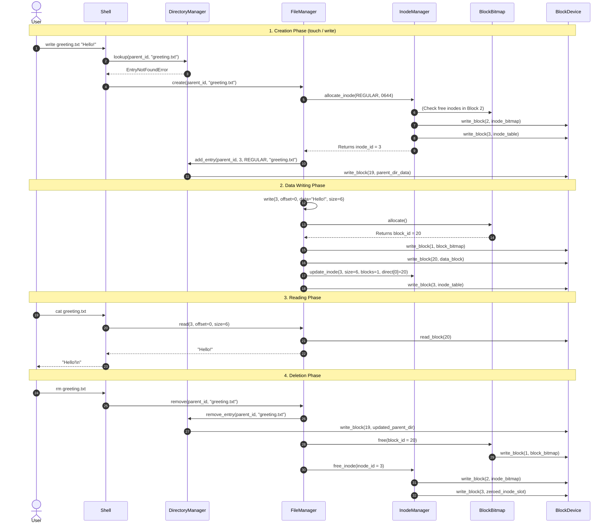

# Filler – End-to-End User Operations & Lifecycle Guide

This document provides a complete operational guide for **Filler**. It details every supported CLI command, demonstrating command syntax, terminal output, internal subsystem interactions, and exact on-disk modifications. It also traces the complete end-to-end lifecycle of a file and explains how persistence across sessions works.

---

## 1. Supported Command Reference

### 1.1 `format`
- **Syntax**: `format`
- **Purpose**: Initializes the 64 MiB disk image with a fresh Filler filesystem layout.
- **Example**:
  ```text
  filler:/> format
  Filesystem successfully formatted.
  ```
- **Internal Behavior**:
  1. Checks if the image file is 64 MiB; if undersized, resizes it using `ftruncate()`.
  2. `Formatter` constructs a default `Superblock` and writes it to Block 0.
  3. `BlockBitmap` marks Blocks 0..18 as allocated; writes to Block 1.
  4. `InodeManager` marks Inodes 0 and 1 as allocated; writes to Block 2.
  5. Clears Inode Table (Blocks 3..18) with zeroes.
  6. `DirectoryManager` creates Root Directory Inode 1 with entries `.` and `..` in Block 19.
  7. `Shell` re-inspects volume, transitioning `fs_state_` to `VALID`.
- **Disk Modifications**: Blocks 0, 1, 2, 3..18, and 19 are written.

---

### 1.2 `pwd`
- **Syntax**: `pwd`
- **Purpose**: Prints the current working directory path.
- **Example**:
  ```text
  filler:/docs/project> pwd
  /docs/project
  ```
- **Internal Behavior**: Reads `current_path_` tracked in `Shell`.
- **Disk Modifications**: None (read-only in-memory access).

---

### 1.3 `cd [path]`
- **Syntax**: `cd [path]`
- **Purpose**: Changes the current working directory. If path is omitted, defaults to `/`.
- **Example**:
  ```text
  filler:/> cd docs
  filler:/docs> cd ..
  filler:/>
  ```
- **Internal Behavior**:
  1. Calls `resolve_path(path, &canonical)`.
  2. Looks up target inode via `DirectoryManager::lookup()`.
  3. Reads target inode via `InodeManager::get_inode()`.
  4. Validates `inode.is_directory()`. If false, outputs `Error: Not a directory`.
  5. Updates `current_dir_inode_` and `current_path_`.
- **Disk Modifications**: None.

---

### 1.4 `ls [path]`
- **Syntax**: `ls [path]`
- **Purpose**: Lists directory entries or displays information for a specific file.
- **Example**:
  ```text
  filler:/> ls
  [DIR]  .
  [DIR]  ..
  [DIR]  docs
  [FILE] notes.txt (42 bytes)
  ```
- **Internal Behavior**:
  1. Resolves path to target inode (or uses `current_dir_inode_` if omitted).
  2. If target is directory: calls `DirectoryManager::list(target_inode)` to parse packed records; for each record, fetches inode to report size or `[DIR]` tag.
  3. If target is file: prints filename and size.
- **Disk Modifications**: Updates directory inode `atime_sec`.

---

### 1.5 `mkdir <path>`
- **Syntax**: `mkdir <path>`
- **Purpose**: Creates a new directory.
- **Example**:
  ```text
  filler:/> mkdir src
  ```
- **Internal Behavior**:
  1. Splits path into parent path and directory name.
  2. Resolves parent directory inode.
  3. `DirectoryManager::mkdir()`:
     - Allocates fresh inode (`FileType::DIRECTORY`, permissions `0755`) via `InodeManager`.
     - Allocates first data block via `BlockBitmap`.
     - Writes `.` (pointing to new inode) and `..` (pointing to parent inode) into data block.
     - Adds entry to parent directory using `DirectoryManager::add_entry()`.
- **Disk Modifications**: Inode Bitmap (Block 2), Inode Table block, Block Bitmap (Block 1), new directory data block, parent directory data block, and Superblock counters.

---

### 1.6 `touch <path>`
- **Syntax**: `touch <path>`
- **Purpose**: Creates an empty regular file if it does not exist, or updates timestamps if it exists.
- **Example**:
  ```text
  filler:/> touch file.txt
  ```
- **Internal Behavior**:
  1. Splits path into parent and file name.
  2. Checks if file exists via `DirectoryManager::lookup()`.
  3. If not found: calls `FileManager::create()`, which allocates an inode (`FileType::REGULAR`), sets size to 0, and links it in parent directory.
  4. If found: updates `mtime_sec` and `atime_sec`.
- **Disk Modifications**: Inode Bitmap (Block 2), Inode Table block, parent directory data block.

---

### 1.7 `write <path> [offset] "<text>"`
- **Syntax**: `write <path> [offset] "<text>"` (quotes are optional if no spaces; supports escape sequences `\n`, `\t`, `\"`).
- **Purpose**: Writes text content to a regular file at an optional byte offset (defaults to 0).
- **Examples**:
  ```text
  filler:/> write hello.txt "Hello, World!\n"
  filler:/> write hello.txt 7 "Filler!"
  ```
- **Internal Behavior**:
  1. Parses arguments, unescaping special characters.
  2. If file does not exist, automatically creates it.
  3. `FileManager::write()` calculates logical blocks needed.
  4. Allocates data blocks and indirect tables via `BlockBitmap` as required.
  5. Performs read-modify-write on boundary blocks and writes full 4096-byte blocks.
  6. Updates file size and `mtime_sec`.
- **Disk Modifications**: Block Bitmap, Inode Table block, allocated data blocks, indirect table blocks (if size > 64 KiB).

---

### 1.8 `append <path> "<text>"`
- **Syntax**: `append <path> "<text>"`
- **Purpose**: Appends text directly to the end of a regular file.
- **Example**:
  ```text
  filler:/> append log.txt "Entry 1\n"
  ```
- **Internal Behavior**: Calls `FileManager::append()`, which determines `offset = inode.size_bytes` and calls `FileManager::write()`.
- **Disk Modifications**: Appends data to trailing block (or allocates new block) and updates inode `size_bytes`.

---

### 1.9 `cat <path>`
- **Syntax**: `cat <path>`
- **Purpose**: Reads and displays the entire content of a file to the terminal.
- **Example**:
  ```text
  filler:/> cat hello.txt
  Hello, World!
  filler:/>
  ```
- **Internal Behavior**:
  1. Resolves path to file inode. Verifies it is not a directory.
  2. Reads content from byte offset 0 to `inode.size_bytes` via `FileManager::read()`.
  3. Streams bytes to terminal; appends a newline if file does not end with `\n` to maintain a clean shell prompt on the next line.
- **Disk Modifications**: Inode `atime_sec` updated in Inode Table.

---

### 1.10 `truncate <path> <size>`
- **Syntax**: `truncate <path> <size>`
- **Purpose**: Resizes a file to the specified size in bytes.
- **Example**:
  ```text
  filler:/> truncate bigfile.bin 1048576
  ```
- **Internal Behavior**:
  1. If shrinking: frees all completely unused blocks, zeroes partial trailing block slack space, updates `size_bytes`.
  2. If growing: uses `TruncateRollbackContext` to allocate blocks and indirect pointer tables safely; rolls back all modifications if disk space runs out.
- **Disk Modifications**: Block Bitmap, Inode Table block, indirect pointer tables, zeroed block tails.

---

### 1.11 `rm <path>`
- **Syntax**: `rm <path>`
- **Purpose**: Deletes a regular file and releases its disk blocks and inode.
- **Example**:
  ```text
  filler:/> rm notes.txt
  ```
- **Internal Behavior**:
  1. Resolves file and parent inode. Verifies target is a regular file.
  2. Unlinks directory entry from parent directory *first*.
  3. Traverses direct blocks, single-indirect tables, and double-indirect tables, freeing each block in `BlockBitmap`.
  4. Releases inode in `InodeManager`.
- **Disk Modifications**: Parent directory data block, Block Bitmap, Inode Bitmap, Inode Table.

---

### 1.12 `rmdir <path>`
- **Syntax**: `rmdir <path>`
- **Purpose**: Deletes an empty directory.
- **Example**:
  ```text
  filler:/> rmdir old_folder
  ```
- **Internal Behavior**:
  1. Resolves directory inode. Verifies it is a directory.
  2. Rejects deletion if inode is root (`1`).
  3. Verifies directory is empty (contains only `.` and `..`).
  4. Removes entry from parent directory.
  5. Frees directory data block(s) and inode.
- **Disk Modifications**: Parent directory data block, Block Bitmap, Inode Bitmap, Inode Table.

---

### 1.13 `stat <path>`
- **Syntax**: `stat <path>`
- **Purpose**: Displays detailed inode metadata for a file or directory.
- **Example**:
  ```text
  filler:/> stat notes.txt
  Inode:       3
  Type:        Regular File
  Permissions: 0644
  UID/GID:     0/0
  Size:        42 bytes
  Blocks:      1
  Access Time: 2026-11-14 13:45:10
  Modify Time: 2026-11-14 13:45:10
  Change Time: 2026-11-14 13:45:10
  Direct Blocks: [ 20, 0, 0, 0, 0, 0, 0, 0, 0, 0, 0, 0, 0, 0, 0, 0 ]
  Single Indirect: 0
  Double Indirect: 0
  ```
- **Internal Behavior**: Reads inode directly from Inode Table and formats all fields.
- **Disk Modifications**: None.

---

### 1.14 `help` & `exit`
- **`help`**: Prints list of supported commands with syntax.
- **`exit`**: Closes BlockDevice cleanly and terminates the shell.

---

## 2. Complete File Lifecycle Trace

The diagram below traces the exact chronological sequence of internal operations and disk writes when a user creates, writes, reads, and deletes a file:



---

## 3. Persistence Across Sessions

Filler provides full persistent storage on the host filesystem:

1. **Session Termination**:
   When the user types `exit`, `Shell` destructs its subsystems and releases `BlockDevice`. The `BlockDevice` destructor invokes POSIX `close(fd_)`, ensuring all pending dirty pages in the host kernel buffer cache are scheduled for disk write.
2. **Session Relaunch**:
   When `./bin/filler filler.img` is executed again:
   - `Shell::Shell()` opens `filler.img`.
   - `Shell::inspect_filesystem()` reads Block 0.
   - It validates the magic number `0x46494C4C`, format version `1`, and runs `Superblock::validate()`.
   - `InodeManager` and `BlockBitmap` read Blocks 2 and 1 to repopulate their in-memory state.
   - Root directory (Inode 1) is ready immediately. All files, directories, sizes, and timestamps match the state left at exit.

